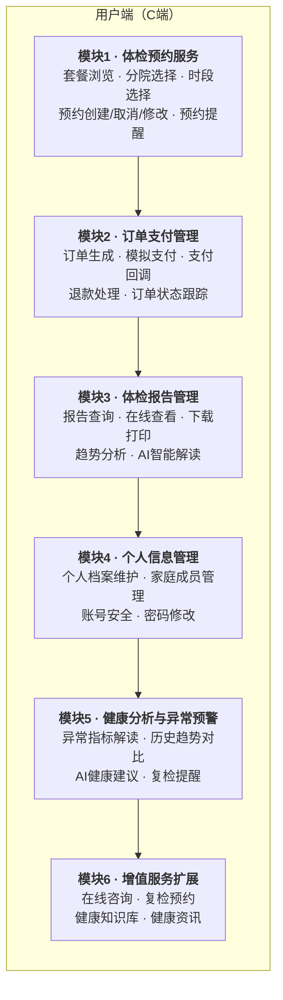
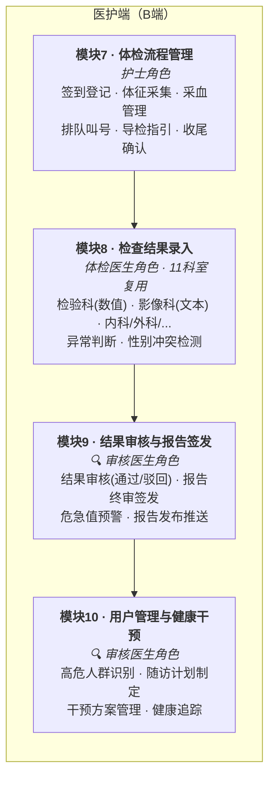
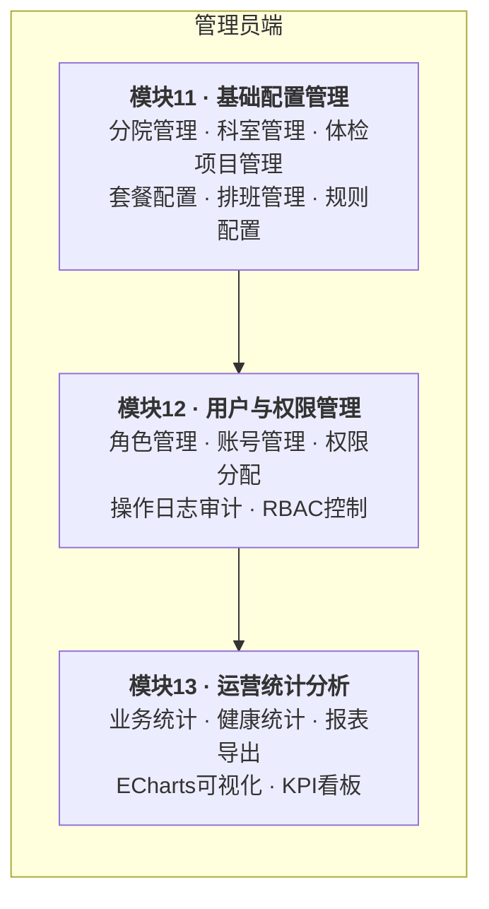
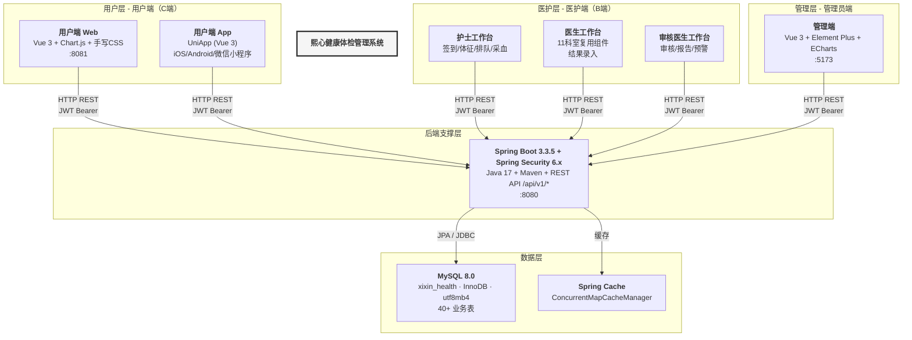
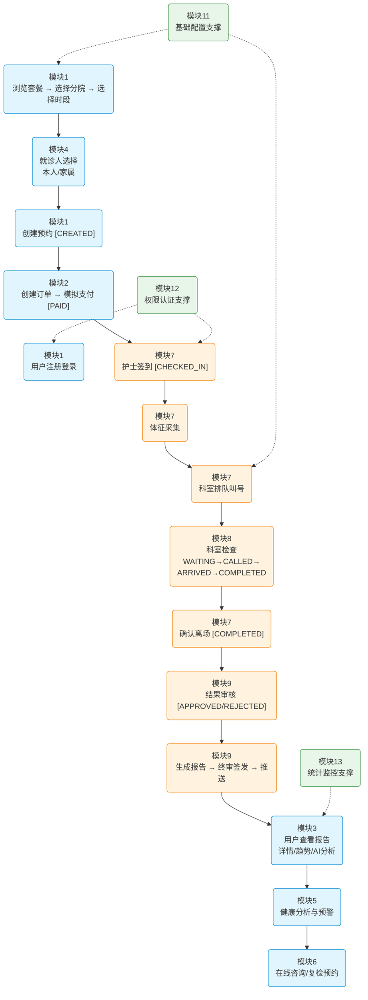
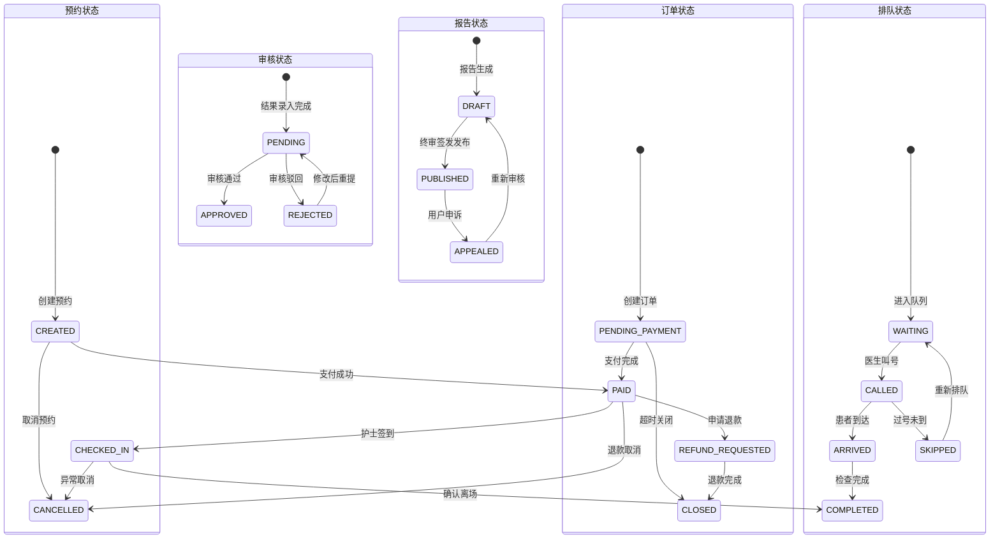

# 熙心健康体检管理系统 - 系统功能模块图

> **生成依据：** 《软件工程实践课程设计报告-第04组-已填写_v3.docx》第3.3.3节 系统功能模块图、第6.3节 核心功能模块实现  
> **生成日期：** 2026年7月

---

## 一、系统功能模块总图

熙心健康体检管理系统共划分为 **13个核心功能模块**，按使用端分为三类：**用户端（C端）6个模块**、**医护端（B端）4个模块**、**管理员端3个模块**。

```mermaid
graph TB
    classDef cend fill:#e1f5fe,stroke:#0288d1,stroke-width:2px
    classDef bend fill:#fff3e0,stroke:#f57c00,stroke-width:2px
    classDef admin fill:#e8f5e9,stroke:#388e3c,stroke-width:2px
    classDef title fill:#f5f5f5,stroke:#333,stroke-width:3px

    TITLE["<b>熙心健康体检管理系统</b>"]:::title

    subgraph 用户端C端["用户端（C端）· 模块 1 ~ 6"]
        direction TB
        M1["<b>模块1</b><br/>体检预约服务"]:::cend
        M2["<b>模块2</b><br/>订单支付管理"]:::cend
        M3["<b>模块3</b><br/>体检报告管理"]:::cend
        M4["<b>模块4</b><br/>个人信息管理"]:::cend
        M5["<b>模块5</b><br/>健康分析与异常预警"]:::cend
        M6["<b>模块6</b><br/>增值服务扩展"]:::cend
    end

    subgraph 医护端B端["医护端（B端）· 模块 7 ~ 10"]
        direction TB
        M7["<b>模块7</b><br/>体检流程管理<br/><i>（护士台）</i>"]:::bend
        M8["<b>模块8</b><br/>检查结果录入<br/><i>（体检医生）</i>"]:::bend
        M9["<b>模块9</b><br/>结果审核与报告签发<br/><i>（审核医生）</i>"]:::bend
        M10["<b>模块10</b><br/>用户管理与健康干预<br/><i>（审核医生）</i>"]:::bend
    end

    subgraph 管理员端["管理员端 · 模块 11 ~ 13"]
        direction TB
        M11["<b>模块11</b><br/>基础配置管理"]:::admin
        M12["<b>模块12</b><br/>用户与权限管理"]:::admin
        M13["<b>模块13</b><br/>运营统计分析"]:::admin
    end

    TITLE --> 用户端C端
    TITLE --> 医护端B端
    TITLE --> 管理员端
```

---

## 二、13个核心功能模块详细说明

### 模块1~6：用户端（C端）

| 模块 | 名称 | 核心功能 | 用户场景 |
|------|------|----------|----------|
| **1** | **体检预约服务** | 套餐浏览、分院选择、时段选择、预约创建/取消/修改、预约成功短信通知、号源防超卖保护 | 用户浏览8种体检套餐，选择分院和时段完成体检预约，高峰期支持号源排队等待 |
| **2** | **订单支付管理** | 订单生成、模拟支付、支付回调处理、退款申请与处理、订单状态全流程跟踪 | 用户预约后生成订单，完成支付后可查看支付状态，需要退款时发起退款流程 |
| **3** | **体检报告管理** | 报告在线查看、PDF下载打印、历年报告归档、异常指标标红高亮、AI趋势分析 | 用户在线查看体检报告详情，支持3个Tab页切换（报告详情/趋势分析/AI解读） |
| **4** | **个人信息管理** | 个人档案维护、家庭成员CRUD、身份证/手机号绑定、密码修改、账号安全 | 用户维护本人及家属的健康档案，可为家属代预约体检，一人一档建立健康数据基础 |
| **5** | **健康分析与异常预警** | 异常指标专项解读、历年指标趋势对比、AI健康建议生成、复检提醒推送 | DeepSeek AI基于历年数据生成趋势解读，帮助用户直观了解健康状况变化 |
| **6** | **增值服务扩展** | 在线AI咨询（智谱API）、复检预约、健康知识库、健康资讯推送 | 用户可与AI健康助手对话咨询，获取检前准备指导和健康知识 |

### 模块7~10：医护端（B端）

| 模块 | 名称 | 负责角色 | 核心功能 | 技术要点 |
|------|------|----------|----------|----------|
| **7** | **体检流程管理** | **护士** | 签到登记、生命体征采集（身高/体重/血压/心率/体温）、采血管理、标本送检、科室排队叫号、智能导检路线优化、收尾确认离场 | `DepartmentQueueService` 基于时段优先级+空腹项目优先的排队策略；导检单使用2-opt启发式算法优化科室路线 |
| **8** | **检查结果录入** | **体检医生** （含11个科室子角色） | 检验科数值型结果录入（带参考范围校验）、影像/内科/外科/眼科/耳鼻喉科/口腔科等文本型结论录入、异常指标自动标记、性别冲突检测 | 11个科室路由复用同一 `DepartmentDoctor.vue` 组件，通过 `meta.departmentId` 区分；内置性别冲突检测 |
| **9** | **结果审核与报告签发** | **审核医生** | 待审核结果列表（通过/驳回）、报告诊断填写、综合终审签发、危急值预警处理（`t_critical_alert`）、报告发布与推送 | 审核状态机：`PENDING → APPROVED / REJECTED`；报告状态：`DRAFT → PUBLISHED / APPEALED` |
| **10** | **用户管理与健康干预** | **审核医生** | 高危人群识别与分级（`t_high_risk_record`）、随访计划制定（`t_follow_up_plan`）、干预方案管理（`t_intervention_plan`）、健康追踪 | 基于体检结果的风险等级划分，支持制定饮食/运动/用药等综合干预方案 |

### 模块11~13：管理员端

| 模块 | 名称 | 核心功能 | 说明 |
|------|------|----------|------|
| **11** | **基础配置管理** | 分院CRUD、科室CRUD、体检项目CRUD、套餐配置（含项目关联）、医生排班、业务规则配置、流程节点配置、报告模板管理 | 运营管理员权限范围限制到所属分院；金额以分为单位存储避免浮点精度问题 |
| **12** | **用户与权限管理** | 角色CRUD+权限分配（`sys_role`/`sys_permission`）、管理员账号CRUD（`sys_user`）、操作审计日志查询（`t_operation_log`，含SHA-256哈希链） | RBAC权限控制粒度到按钮级别；审计日志哈希链防篡改：`entry_hash = SHA256(prev_hash + detail + timestamp)` |
| **13** | **运营统计分析** | 业务KPI看板（订单量/营收/体检人数）、健康指标统计（异常率/疾病分布）、Excel/PDF/CSV报表导出、ECharts可视化图表 | `TendAnalysisService` 集成DeepSeek API生成健康趋势分析，结果缓存1小时避免重复调用 |

---

## 三、系统功能模块架构图

---

## 四、系统功能模块与角色对应关系

```mermaid
graph TB
    classDef cend fill:#e1f5fe,stroke:#0288d1
    classDef bend fill:#fff3e0,stroke:#f57c00
    classDef admin fill:#e8f5e9,stroke:#388e3c
    classDef userrole fill:#bbdefb,stroke:#1976d2
    classDef nurerole fill:#ffe0b2,stroke:#e65100
    classDef docrole fill:#ffccbc,stroke:#bf360c
    classDef revrole fill:#d1c4e9,stroke:#4527a0
    classDef admrole fill:#c8e6c9,stroke:#1b5e20

    NORMAL_USER["NORMAL_USER<br/>普通用户"]:::userrole

    NURSE["NURSE<br/>护士"]:::nurerole

    EXAM_DOCTOR["EXAM_DOCTOR<br/>体检医生（父角色）"]:::docrole
    LAB["EXAM_DOCTOR_LAB<br/>检验科"]:::docrole
    IMG["EXAM_DOCTOR_IMAGING<br/>影像科"]:::docrole
    INTERNAL["EXAM_DOCTOR_INTERNAL<br/>内科"]:::docrole
    SURGERY["EXAM_DOCTOR_SURGERY<br/>外科"]:::docrole
    OPHTHALM["EXAM_DOCTOR_OPHTHALM<br/>眼科"]:::docrole
    ENT["EXAM_DOCTOR_ENT<br/>耳鼻喉科"]:::docrole
    DENTAL["EXAM_DOCTOR_DENTAL<br/>口腔科"]:::docrole
    ECG["EXAM_DOCTOR_ECG<br/>心电图"]:::docrole
    US["EXAM_DOCTOR_ULTRASOUND<br/>B超"]:::docrole
    BMD["EXAM_DOCTOR_BMD<br/>骨密度"]:::docrole
    BLOOD["EXAM_DOCTOR_BLOOD<br/>采血"]:::docrole

    REVIEW["REVIEW_DOCTOR<br/>审核医生"]:::revrole

    SYS_ADMIN["SYSTEM_ADMIN<br/>系统管理员"]:::admrole
    OPS_ADMIN["OPERATIONS_ADMIN<br/>运营管理员"]:::admrole

    subgraph 模块_用户端["模块1~6：用户端"]
        M1["模块1 · 体检预约服务"]
        M2["模块2 · 订单支付管理"]
        M3["模块3 · 体检报告管理"]
        M4["模块4 · 个人信息管理"]
        M5["模块5 · 健康分析与异常预警"]
        M6["模块6 · 增值服务扩展"]
    end

    subgraph 模块_医护端["模块7~10：医护端"]
        M7["模块7 · 体检流程管理"]
        M8["模块8 · 检查结果录入"]
        M9["模块9 · 结果审核与报告签发"]
        M10["模块10 · 用户管理与健康干预"]
    end

    subgraph 模块_管理端["模块11~13：管理员端"]
        M11["模块11 · 基础配置管理"]
        M12["模块12 · 用户与权限管理"]
        M13["模块13 · 运营统计分析"]
    end

    NORMAL_USER --> 模块_用户端

    NURSE --> M7
    LAB & IMG & INTERNAL & SURGERY & OPHTHALM & ENT & DENTAL & ECG & US & BMD & BLOOD --> M8
    EXAM_DOCTOR --> LAB
    EXAM_DOCTOR --> IMG
    EXAM_DOCTOR --> INTERNAL
    EXAM_DOCTOR --> SURGERY
    EXAM_DOCTOR --> OPHTHALM
    EXAM_DOCTOR --> ENT
    EXAM_DOCTOR --> DENTAL
    EXAM_DOCTOR --> ECG
    EXAM_DOCTOR --> US
    EXAM_DOCTOR --> BMD
    EXAM_DOCTOR --> BLOOD
    
    REVIEW --> M9
    REVIEW --> M10

    SYS_ADMIN --> 模块_管理端
    OPS_ADMIN --> 模块_管理端
```

---

## 五、核心业务流程（模块协同）

---

## 六、数据支撑关系

```mermaid
graph TB
    classDef cend fill:#e1f5fe,stroke:#0288d1
    classDef bend fill:#fff3e0,stroke:#f57c00
    classDef admin fill:#e8f5e9,stroke:#388e3c
    classDef table fill:#f5f5f5,stroke:#888

    subgraph 模块_用户端["📱 用户端模块（1-6）"]
        M1["模块1 · 体检预约服务"]:::cend
        M2["模块2 · 订单支付管理"]:::cend
        M3["模块3 · 体检报告管理"]:::cend
        M4["模块4 · 个人信息管理"]:::cend
        M6["模块6 · 增值服务扩展"]:::cend
    end

    subgraph 模块_医护端["🏥 医护端模块（7-10）"]
        M7["模块7 · 体检流程管理"]:::bend
        M8["模块8 · 检查结果录入"]:::bend
        M9["模块9 · 结果审核与报告签发"]:::bend
        M10["模块10 · 用户管理与健康干预"]:::bend
    end

    subgraph 模块_管理端["⚙️ 管理员端模块（11-13）"]
        M11["模块11 · 基础配置管理"]:::admin
        M12["模块12 · 用户与权限管理"]:::admin
        M13["模块13 · 运营统计分析"]:::admin
    end

    subgraph 核心数据表["📊 约40+ 核心业务表"]
        T1["sys_user · sys_role<br/>sys_permission · sys_user_role<br/>sys_role_permission"]:::table
        T2["t_branch · t_department<br/>t_exam_item · t_exam_package<br/>t_exam_package_item"]:::table
        T3["t_appointment · t_order<br/>t_payment_record · t_refund_record"]:::table
        T4["t_exam_record · t_exam_progress<br/>t_department_queue · t_vital_signs<br/>t_specimen · t_guide_sheet"]:::table
        T5["t_check_result · t_result_review<br/>t_critical_alert"]:::table
        T6["t_exam_report · t_health_analysis<br/>t_health_management"]:::table
        T7["t_health_profile · t_family_member<br/>t_notification · t_operation_log<br/>t_pre_exam_questionnaire · t_contact_message"]:::table
        T8["t_high_risk_record · t_follow_up_plan<br/>t_intervention_plan"]:::table
    end

    M12 --> T1
    M11 --> T2
    M1 & M2 --> T3
    M7 --> T4
    M8 & M9 --> T5
    M3 & M9 --> T6
    M4 & M6 --> T7
    M10 --> T8
    M13 --> T3 & T6
```

---

## 七、状态流转关系

---

> **说明：** 本功能模块图完全按照《软件工程实践课程设计报告》中第3.3.3节（系统功能模块图）和第6.3节（核心功能模块实现）的13个核心功能模块体系编制，与报告中图3-1、表3-1、表6-3保持一致。
