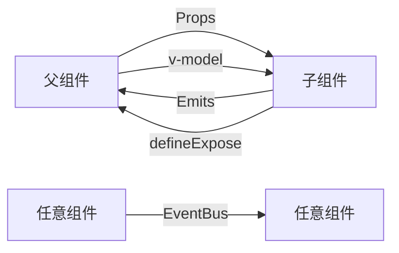

# uni-app x (UserPhone) 完整用法文档

> 基于 UserPhone 项目整理的 uni-app x（Vue3 + UTS）完整开发指南
> 项目文件: `UserPhone/` — 一个跨平台（Android/iOS/Harmony/Web/微信小程序）的 uni-app x 演示项目

---

## 目录

1. [项目结构概览](#1-项目结构概览)
2. [入口与生命周期](#2-入口与生命周期)
3. [页面配置 (pages.json)](#3-页面配置-pagesjson)
4. [页面定义 (.uvue / .vue)](#4-页面定义-uvue--vue)
5. [UTS 类型系统](#5-uts-类型系统)
6. [响应式数据与状态管理](#6-响应式数据与状态管理)
7. [组件定义与通信](#7-组件定义与通信)
8. [内置组件用法](#8-内置组件用法)
9. [uni  API 用法](#9-uni-api-用法)
10. [CSS 样式用法](#10-css-样式用法)
11. [条件编译](#11-条件编译)
12. [模板与业务页面](#12-模板与业务页面)
13. [测试模式 (.test.js)](#13-测试模式-testjs)
14. [UniCloud 云开发](#14-unicloud-云开发)
15. [构建与主题配置](#15-构建与主题配置)
16. [Web Worker 与多线程](#16-web-worker-与多线程)
17. [最佳实践总结](#17-最佳实践总结)

---

## 1. 项目结构概览

```
UserPhone/
├── App.uvue                      # 应用入口组件（全局生命周期、样式）
├── main.uts                      # 应用启动入口（createSSRApp）
├── manifest.json                 # 应用配置（跨平台）
├── pages.json                    # 页面路由配置
├── theme.json                    # 明/暗主题变量
├── env.js                        # 环境变量
├── uni.scss                      # SCSS 变量定义
├── pages/                        # 页面目录
│   ├── tabBar/                   # 底部 Tab 页面
│   ├── component/                # 内置组件演示页
│   ├── CSS/                      # CSS 样式演示页
│   ├── API/                      # API 功能演示页
│   └── template/                 # 模板/业务页面
├── components/                   # 公共组件
├── store/                        # 全局状态管理
├── common/                       # 公共资源（uni.css）
├── static/                       # 静态资源
├── uni_modules/                  # uni 插件模块
├── uniCloud-aliyun/             # 阿里云云函数
├── workers/                      # Web Worker
├── hybrid/                       # 混合渲染
├── windows/                      # 多窗口（左窗/顶窗）
└── wxcomponents/                 # 微信小程序自定义组件
```

### 文件后缀说明

| 后缀 | 说明 | 用途 |
|------|------|------|
| `.uvue` | uni-app x 的 Vue 单文件 | **推荐**，支持 UTS 语法 |
| `.vue` | 标准 Vue 单文件 | 兼容模式，适用于非 UTS 场景 |
| `.uts` | uni-app x TypeScript | 纯逻辑、类型定义、工具函数 |
| `.test.js` | 自动化测试文件 | 配合 uni-app 自动化测试框架 |
| `.json` | 静态 JSON / 配置文件 | pages.json、manifest.json 等 |

---

## 2. 入口与生命周期

### 2.1 main.uts — 应用启动入口

```typescript
// main.uts
import App from './App.uvue'
import { createSSRApp } from 'vue'

export function createApp() {
  const app = createSSRApp(App)
  
  // 使用插件
  // #ifdef APP-ANDROID || APP-IOS || WEB || MP-WEIXIN || APP-HARMONY
  app.use(uniStat, uniStatOptions)
  // #endif
  
  return { app }
}
```

关键点：
- 必须导出 `createApp` 函数（uni-app x 规范）
- 使用 `createSSRApp`（而非 `createApp`）创建实例
- 插件注册使用 `app.use()`
- 条件编译包裹平台特定的插件调用

### 2.2 App.uvue — 全局应用组件

```typescript
<script setup lang="uts">
// 全局生命周期
onLaunch((res: OnLaunchOptions) => {
  // 应用启动时触发（仅一次）
  uni.report({ name: 'uni-app-launch', options: res })
})

onAppShow((res: OnShowOptions) => {
  // 应用从后台回到前台
  uni.report({ name: 'uni-app-show' })
})

onAppHide(() => {
  // 应用进入后台
  uni.report({ name: 'uni-app-hide' })
})

// 特定平台
// #ifdef APP-ANDROID || APP-HARMONY
onLastPageBackPress(() => {
  // 在最后一个页面按返回键（双次退出）
})

onExit(() => {
  // 应用退出
})
// #endif

onError((err: any) => {
  // 全局错误捕获
  uni.report({ name: 'uni-app-error', options: err })
})

// 暴露方法给子组件
defineExpose({ increaseLifeCycleNum })
</script>

<style>
/* 全局样式 */
@import "./common/uni.css";

.global-text {
  color: #007AFF;
  font-size: 18px;
  font-weight: bold;
}
</style>
```

**生命周期对比表**

| App 生命周期 | 页面生命周期 | 说明 |
|-------------|-------------|------|
| `onLaunch` | `onLoad` | 启动/进入页面 |
| `onAppShow` | `onPageShow` | 显示/前台 |
| `onAppHide` | `onHide` | 隐藏/后台 |
| — | `onReady` | 页面初次渲染完成 |
| `onError` | — | 全局错误 |
| `onLastPageBackPress` | `onBackPress` | 返回键 |
| `onExit` | `onBeforeUnmount` | 退出/卸载 |

---

## 3. 页面配置 (pages.json)

### 3.1 基本结构

```json
{
  "leftWindow": { "path": "windows/left-window.uvue", "style": { "width": "350px" } },
  "topWindow": { "path": "windows/top-window.uvue", "style": { "height": "60px" } },
  "pages": [
    {
      "path": "pages/component/view/view",
      "group": "0,1,0",
      "style": {
        "navigationBarTitleText": "view | 基本视图容器"
      }
    }
  ],
  "subPackages": [
    {
      "root": "pages/API/get-file-system-manager",
      "pages": [
        { "path": "get-file-system-manager", ... }
      ]
    }
  ],
  "tabBar": { ... },
  "preloadRule": { ... },
  "globalStyle": { ... }
}
```

### 3.2 条件编译在 pages.json 中的应用

```json
// #ifdef APP-ANDROID || APP-IOS || WEB || MP-WEIXIN || APP-HARMONY
{
  "path": "pages/component/view/view",
  "style": { "navigationBarTitleText": "view" }
},
// #endif
```

支持所有平台标识：
- `APP-ANDROID`, `APP-IOS`, `APP-HARMONY` — App 端
- `WEB` — Web/H5 端
- `MP-WEIXIN` — 微信小程序
- `VUE3-VAPOR` — Vapor 模式
- `!VUE3-VAPOR` — 非 Vapor 模式

### 3.3 group 分组机制

`group: "0,1,0"` 表示三级菜单的索引路径，配合 `generateMenu.uts` 自动生成导航菜单。

### 3.4 页面样式配置

```json
{
  "style": {
    "navigationBarTitleText": "页面标题",
    "navigationBarTextStyle": "white",
    "navigationBarBackgroundColor": "#007AFF",
    "backgroundColorContent": "@tabBarPagebackgroundColorContent",
    "enablePullDownRefresh": true,
    "navigationStyle": "custom"
  }
}
```

- `@变量名` 引用 `theme.json` 中的主题变量
- `navigationStyle: "custom"` 隐藏导航栏

---

## 4. 页面定义 (.uvue / .vue)

### 4.1 标准页面模板

```vue
<template>
  <!-- #ifdef APP -->
  <scroll-view style="flex: 1;">
  <!-- #endif -->
  <view class="uni-container">
    <page-head :title="data.title"></page-head>
    
    <view class="uni-list">
      <view class="uni-list-cell" @tap="handleTap">
        <text>{{ data.text }}</text>
      </view>
    </view>
    
    <button type="default" @tap="doSomething">按钮</button>
  </view>
  <!-- #ifdef APP -->
  </scroll-view>
  <!-- #endif -->
</template>

<script setup lang="uts">
// 类型定义
type DataType = {
  title: string;
  text: string;
  items: string[];
}

// 响应式数据（推荐使用 reactive 以便测试访问）
const data = reactive({
  title: '页面标题',
  text: '示例文本',
  items: ['a', 'b', 'c']
} as DataType)

// 计算属性
const computedValue = computed((): string => {
  return data.title + '!'
})

// 生命周期
onLoad(() => {
  // 页面加载
})

onPageShow(() => {
  // 页面显示
})

onReady(() => {
  // 页面初次渲染完成
})

onHide(() => {
  // 页面隐藏
})

onBeforeUnmount(() => {
  // 页面卸载前
})

// 方法
function handleTap() {
  uni.showToast({ title: '点击了' })
}

// 暴露给测试/父组件
defineExpose({
  data,
  handleTap
})
</script>

<style>
.uni-container {
  padding: 20px;
}
.uni-list-cell {
  padding: 10px;
  border-bottom: 1px solid #eee;
}
</style>
```

### 4.2 响应式数据的两种方式

**方式一：reactive（推荐）**

```typescript
const data = reactive({ ... } as DataType)
// 优势：自动化测试可直接通过 setData 访问
```

**方式二：ref**

```typescript
const count = ref(0)
const list = ref<string[]>([])
```

### 4.3 页面模板 ref

```typescript
const pageScrollView = ref<UniScrollViewElement|null>(null)
const header = ref<UniElement|null>(null)
const tabScroll = ref<UniScrollViewElement|null>(null)
const swiper = ref<UniSwiperElement|null>(null)
const longPageRef = ref<ComponentPublicInstance[]|null>(null)
```

### 4.4 defineExpose

```typescript
defineExpose({
  data,
  getLifeCycleNum,
  hideActionSheet,
  setLifeCycleNumFunc,
  showActionSheetAndNavigateBackInSuccessCallback
})
```

暴露的方法可以在自动化测试中用 `page.callMethod()` 调用，也可被父组件通过 ref 访问。

### 4.5 Template 中 v-for 与事件绑定

```html
<view v-for="(item, index) in data.items" :key="item.value" @tap="handleItem(item)">
  <text>{{ item.name }}</text>
</view>

<radio-group @change="radioChange">
  <radio v-for="(item, index) in data.items" :key="item.value"
    :value="item.value" :checked="index === data.current">
    {{ item.name }}
  </radio>
</radio-group>
```

---

## 5. UTS 类型系统

### 5.1 类型定义 (.uts 文件)

```typescript
// components/enum-data/enum-data-types.uts
export type ItemType = { 
  value: number;
  name: string;
  checked?: boolean;  // 可选属性
}
```

### 5.2 联合类型与复杂类型

```typescript
export type GlobalData = {
  str: string
  num: number
  bool: boolean
  obj: UTSJSONObject           // 通用 JSON 对象
  null: string | null          // 可为 null
  arr: number[]                // 数组
  set: Set<string>             // Set
  map: Map<string, any>        // Map
  fun: () => string            // 函数类型
  launchOptions: OnLaunchOptions  // uni 类型
}
```

### 5.3 类型断言

```typescript
const data = value as string
const obj = {} as UTSJSONObject
const menu = ref(menuData as MenuItem[])
```

### 5.4 数组类型

```typescript
const arr: string[] = []
const items = ref<ItemType[]>([{ value: 1, name: '选项' }])
```

### 5.5 类型导入

```typescript
import { ItemType } from '@/components/enum-data/enum-data-types'
import { state, setLifeCycleNum } from '@/store/index.uts'
```

### 5.6 UTSJSONObject

用于处理动态 JSON 数据：

```typescript
const obj: UTSJSONObject = {
  str: 'default globalData obj str',
  num: 0,
  bool: false,
} as UTSJSONObject
```

### 5.7 类型推导辅助

```typescript
// 给 compute 添加显式返回类型
const isDarkMode = computed((): boolean => {
  return state.isDarkMode
})
```

---

## 6. 响应式数据与状态管理

### 6.1 全局 Store 模式

```typescript
// store/index.uts
import { reactive } from 'vue'

export const state = reactive({
  globalData: { ... } as GlobalData,
  lifeCycleNum: 0,
  statusBarHeight: 0,
  safeArea: { top: 0, right: 0, bottom: 0, left: 0, width: 0, height: 0 },
  // ...
} as State)

export function setLifeCycleNum(num: number) {
  state.lifeCycleNum = num
}
```

### 6.2 在页面中使用 Store

```typescript
import { state, setLifeCycleNum } from '@/store/index.uts'

const isDarkMode = computed((): boolean => {
  return state.isDarkMode
})
```

### 6.3 响应式特性

- 使用 Vue 3 `reactive()` 创建全局响应式对象
- 使用 `computed()` 创建派生状态
- 所有修改通过导出函数进行（封装性）
- 直接修改 `state.xxx` 也是响应式的

---

## 7. 组件定义与通信

### 7.1 Props 定义

**UTS 版本 (.uvue)：**

```typescript
const props = defineProps({
  title: { type: String, default: '' },
  disabled: { type: Boolean, default: false },
  defaultValue: { type: Boolean, default: false },
  items: {
    type: Array as PropType<Array<ItemType>>,
    required: true
  },
  compact: { type: Boolean, default: false }
})
```

### 7.2 Emits 定义

```typescript
const emit = defineEmits(['change', 'updateFps'])

function _change(e: UniSwitchChangeEvent) {
  emit('change', checkedValue)
}
```

### 7.3 组件通信方式



| 方式 | 实现 | 适用场景 |
|------|------|---------|
| Props | `defineProps` | 父传子 |
| Emits | `defineEmits` | 子传父 |
| Expose | `defineExpose` | 父调用子方法 |
| EventBus | `uni.$on/$emit/$off` | 任意组件通信 |
| Store | `reactive` 全局对象 | 全局状态 |
| v-model | `:modelValue` + `@update:modelValue` | 表单组件 |

### 7.4 组件引用

```typescript
// 子组件
const childRef = ref<ComponentPublicInstance | null>(null)

// 子组件数组
const categoryRef = ref<ComponentPublicInstance[] | null>(null)
```

### 7.5 引入组件

```typescript
// 引入自定义组件
import Child from './child.uvue'
import componenttab from './component.uvue'

// 引入 uni_modules 组件
import tabList from '@/uni_modules/uni-tab-bar/components/uni-tab-bar/tab-list.uvue'
```

### 7.6 defineOptions

```typescript
defineOptions({
  styleIsolation: 'app'  // 样式隔离：app = 受全局样式影响
})
```

### 7.7 组件模板参考：boolean-data.uvue

```vue
<script setup lang="uts">
defineOptions({ styleIsolation: 'app' })
const emit = defineEmits(['change'])
const props = defineProps({
  title: { type: String, default: '' },
  disabled: { type: Boolean, default: false },
  defaultValue: { type: Boolean, default: false }
})
const _checked = ref(false)
onMounted(() => { _checked.value = props.defaultValue })

function _change(e: UniSwitchChangeEvent) {
  _checked.value = e.detail.value
  emit('change', _checked.value)
}
</script>

<template>
  <view class="button-data-main">
    <text>{{ title }}</text>
    <switch :checked="_checked" :disabled="disabled" @change="_change" />
  </view>
</template>
```

---

## 8. 内置组件用法

### 8.1 基础容器

| 组件 | 关键属性 | 示例 |
|------|---------|------|
| `<view>` | `hover-class`, `hover-stop-propagation`, `hover-start-time`, `hover-stay-time`, `flatten` | 基础视图容器 |
| `<scroll-view>` | `ref`, `scroll-y`, `scroll-x`, `enable-back-to-top`, `show-scrollbar`, `bounces` | 可滚动容器 |
| `<swiper>` | `current`, `@transition`, `@animationfinish`, `indicator-dots` | 滑块视图容器 |
| `<list-view>` | — | 列表容器（高性能） |
| `<sticky-section>` | — | 吸顶布局 |
| `<sticky-header>` | — | 吸顶头部 |
| `<waterflow>` | — | 瀑布流 |

### 8.2 表单组件

| 组件 | 事件 | 绑定值 |
|------|------|--------|
| `<input>` | `@input`, `@focus`, `@blur` | `v-model` |
| `<textarea>` | `@input`, `@focus`, `@blur` | `v-model` |
| `<button>` | `@tap`, `@click` | `type`, `disabled`, `loading` |
| `<switch>` | `@change` → `UniSwitchChangeEvent` | `:checked` |
| `<radio>` / `<radio-group>` | `@change` → `RadioGroupChangeEvent` | `:checked`, `:value` |
| `<checkbox>` / `<checkbox-group>` | `@change` | `:checked`, `:value` |
| `<slider>` | `@change` | `:value`, `:max` |
| `<picker>` | `@change` | `:range`, `:value` |
| `<picker-view>` | `@change` | `:value` |
| `<form>` | `@submit` | `report-submit` |

### 8.3 媒体组件

| 组件 | 说明 |
|------|------|
| `<image>` | `src`, `mode`, `lazy-load`, `flatten` |
| `<video>` | `src`, `controls`, `autoplay` |
| `<canvas>` | `type`, `canvas-id` |
| `<camera>` | `device-position`, `flash` |
| `<live-player>` | 实时音视频播放 |
| `<live-pusher>` | 实时音视频推流 |
| `<web-view>` | `src` 加载网页 |

### 8.4 其他组件

| 组件 | 说明 |
|------|------|
| `<text>` | 文本（`selectable`, `space`, `decode`） |
| `<rich-text>` | 富文本渲染（`nodes`） |
| `<progress>` | 进度条（`percent`, `stroke-width`, `color`） |
| `<loading>` | 加载中 |
| `<map>` | 地图 |
| `<navigator>` | 页面导航 |
| `<page-container>` | 页面容器 |
| `<match-media>` | 媒体匹配 |
| `<cover-view>` | 覆盖在地图/视频上的视图 |
| `<movable-view>` | 可拖动视图（需配合 `<movable-area>`） |
| `<label>` | 表单标签增强 |
| `<editor>` | 富文本编辑器 |
| `<ad>` | 广告 |
| `<native-view>` | 原生 View |
| `<page-meta>` | 页面元信息 |
| `<share-element>` | 共享元素动画 |

### 8.5 特殊属性：flatten

`flatten` 属性用于将一个 view 拍平（不生成原生 View 层），提升渲染性能：

```html
<view flatten>
  <text flatten>拍平view</text>
</view>
```

### 8.6 自定义 TabBar 组件

```html
<uni-tab-bar style="flex: 1;" :active-index="activeIndex" @change="handleChange">
  <!-- 内容区域 -->
  <view :style="{visibility:(activeIndex==0?'visible':'hidden')}">
    <componenttab />
  </view>
  
  <!-- 底部选项卡 -->
  <tab-list @click="clickItem">
    <tab-list-item>
      <image :src="activeIndex==0 ? '/static/HL.png' : '/static/N.png'" />
      <text class="tab-label">组件</text>
    </tab-list-item>
  </tab-list>
</uni-tab-bar>
```

---

## 9. uni API 用法

### 9.1 交互反馈

```typescript
// Toast 轻提示
uni.showToast({
  title: '操作成功',
  icon: 'success',  // 'success' | 'error' | 'none'
  duration: 2000
})

// Loading 加载框
uni.showLoading({ title: '加载中...' })
uni.hideLoading()

// Modal 模态弹窗
uni.showModal({
  title: '提示',
  content: '确定要删除吗？',
  success: (res) => { if (res.confirm) { /* 确定 */ } }
})

// ActionSheet 操作菜单
uni.showActionSheet({
  title: '请选择',
  itemList: ['选项1', '选项2'],
  success: (res) => { console.log(res.tapIndex) },
  fail: (err) => { console.log(err.errMsg) },
  complete: () => { }
})

uni.hideActionSheet()
```

### 9.2 导航与页面跳转

```typescript
// 保留当前页面跳转
uni.navigateTo({ url: '/pages/API/action-sheet/action-sheet' })

// 关闭当前页面跳转
uni.redirectTo({ url: '/pages/other' })

// 关闭所有页面跳转
uni.reLaunch({ url: '/pages/other' })

// 返回上一页
uni.navigateBack()

// 设置导航栏
uni.setNavigationBarTitle({ title: '新标题' })
uni.setNavigationBarColor({ 
  frontColor: '#ffffff',
  backgroundColor: '#007AFF'
})

// 页面滚动
uni.pageScrollTo({ scrollTop: 0, duration: 300 })
```

### 9.3 网络请求

```typescript
// 普通请求
uni.request({
  url: 'https://api.example.com/data',
  method: 'GET',
  data: { key: 'value' },
  success: (res) => { console.log(res.data) },
  fail: (err) => { console.log(err) }
})

// 上传文件
uni.uploadFile({
  url: 'https://api.example.com/upload',
  filePath: tempFilePath,
  name: 'file',
  success: (res) => { }
})

// 下载文件
uni.downloadFile({
  url: 'https://example.com/file.pdf',
  success: (res) => { }
})
```

### 9.4 设备信息

```typescript
// 系统信息
uni.getSystemInfo({
  success: (res: GetSystemInfoResult) => {
    console.log(res.platform, res.model)
  }
})
const info = uni.getSystemInfoSync()

// 窗口信息
const windowInfo = uni.getWindowInfo()
// windowInfo.windowWidth, windowInfo.windowHeight, windowInfo.safeAreaInsets

// 设备信息
uni.getDeviceInfo()
uni.getAppBaseInfo()

// 电池信息
uni.getBatteryInfo({ success: (res) => { } })

// 网络类型
uni.getNetworkType({ success: (res) => { } })

// 剪切板
uni.setClipboardData({ data: '要复制的文本' })
uni.getClipboardData({ success: (res) => { } })
```

### 9.5 媒体与文件

```typescript
// 选择图片
uni.chooseImage({
  count: 9,
  sizeType: ['original', 'compressed'],
  sourceType: ['album', 'camera'],
  success: (res) => { res.tempFilePaths }
})

// 预览图片
uni.previewImage({
  urls: ['url1', 'url2'],
  current: 0,
  longPressActions: { itemList: ['发送给朋友'] }
})

// 选择视频
uni.chooseVideo({
  sourceType: ['album', 'camera'],
  maxDuration: 60,
  success: (res) => { }
})
```

### 9.6 数据存储

```typescript
// 存储
uni.setStorageSync('key', value)
uni.setStorage({ key: 'key', data: value })

// 读取
const data = uni.getStorageSync('key')
uni.getStorage({ key: 'key', success: (res) => { } })

// 删除
uni.removeStorageSync('key')

// 清除
uni.clearStorageSync()
```

### 9.7 位置相关

```typescript
// 获取位置
uni.getLocation({
  type: 'gcj02',
  success: (res) => { res.latitude, res.longitude }
})

// 打开地图
uni.openLocation({
  latitude: 39.9,
  longitude: 116.4,
  name: '地点名称'
})

// 选择位置
uni.chooseLocation({ success: (res) => { } })

// 监听位置变化
uni.onLocationChange((res) => { })
```

### 9.8 元素查询

```typescript
// 方式一：getElementById
const element = uni.getElementById('my-element')
const rect = element.getBoundingClientRect()

// 方式二：createSelectorQuery
const query = uni.createSelectorQuery()
query.select('#id').boundingClientRect((rect) => { }).exec()

// 异步获取
const rect = await element.getBoundingClientRectAsync()
```

### 9.9 事件总线

```typescript
// 发送事件
uni.$emit('eventName', data)

// 监听事件
uni.$on('eventName', (data) => { })

// 移除监听
uni.$off('eventName', callback)
```

### 9.10 主题与设置

```typescript
// 获取主题
const appTheme = uni.getSystemInfoSync().appTheme

// 设置主题
uni.setAppTheme({ theme: 'auto' })  // 'light' | 'dark' | 'auto'

// 监听主题变化
uni.onAppThemeChange((res: AppThemeChangeResult) => {
  state.isDarkMode = res.appTheme == 'dark'
})

// 监听宿主主题（Web/小程序）
uni.onHostThemeChange((result) => { })
```

### 9.11 对话框页面 (DialogPage)

```typescript
// 打开一个对话框页面（iOS/Android/Harmony/Web）
uni.openDialogPage({ url: '/pages/component/button/privacy' })
```

### 9.12 缓存 & 渲染控制

```typescript
// 动画帧
let id = requestAnimationFrame(callback)
cancelAnimationFrame(id)

// 拦截器
uni.addInterceptor('request', {
  invoke(args) { /* 请求发起前 */ },
  success(args) { /* 请求成功 */ }
})
```

---

## 10. CSS 样式用法

### 10.1 样式隔离

```vue
<script setup lang="uts">
defineOptions({
  styleIsolation: 'app'  // 全局样式影响本组件
})
</script>
```

### 10.2 CSS 变量

```css
.test-view {
  background-color: var(--list-background-color, #ffffff);
  color: var(--text-color, #333333);
}
```

变量来自 `theme.json` 和组件自身的 CSS 变量。

### 10.3 暗黑主题

```html
<view :class="isDarkMode ? 'theme-dark' : 'theme-light'">
```

```css
.theme-dark {
  background-color: #1F1F1F;
  --text-color: #ffffff;
}
```

### 10.4 常用样式集合

```css
.uni-container { /* 页面容器 */ }
.uni-padding-wrap { padding: 0 15px; }
.uni-list { /* 列表容器 */ }
.uni-list-cell { padding: 15px; border-bottom: 1px solid #eee; }
.uni-btn-v { /* 按钮纵向排列 */ }
.uni-title { font-size: 16px; font-weight: bold; }
.uni-title-text { font-size: 16px; color: #333; }
.uni-common-mt { margin-top: 10px; }
.uni-common-pl { padding-left: 15px; }
.uni-flex { display: flex; }
```

### 10.5 CSS 边界演示

项目中演示了以下所有 CSS 属性：

| 类别 | 属性 |
|------|------|
| 盒模型 | `width`, `height`, `min/max-width/height`, `padding`, `margin`, `border` |
| 定位 | `position`, `top/left/right/bottom`, `z-index` |
| 布局 | `display`, `flex`, `flex-direction`, `flex-wrap`, `justify-content`, `align-items`, `align-content` |
| 文本 | `color`, `font-size`, `font-family`, `font-weight`, `font-style`, `line-height`, `text-align`, `text-decoration`, `text-overflow`, `white-space`, `letter-spacing` |
| 视觉 | `background`, `opacity`, `border-radius`, `box-shadow`, `box-sizing`, `overflow`, `visibility`, `pointer-events` |
| 动画 | `transform`, `transition`, `animation` |
| CSS 函数 | `rgb()`, `rgba()`, `url()` |
| 自定义变量 | `--variable-name` |

### 10.6 条件编译样式

```css
/* #ifdef WEB */
.uni-container.theme-dark {
  min-height: calc(100vh - var(--uni-safe-area-inset-top));
}
/* #endif */

/* #ifdef MP-WEIXIN */
page {
  background-color: #efeff4;
}
/* #endif */
```

### 10.7 SCSS 变量 (uni.scss)

```scss
$uni-color-primary: #007aff;
$uni-color-success: #4cd964;
$uni-color-warning: #f0ad4e;
$uni-color-error: #dd524d;

$uni-text-color: #333;
$uni-bg-color: #ffffff;
$uni-border-color: #c8c7cc;

$uni-font-size-sm: 12px;
$uni-font-size-base: 14px;

$uni-border-radius-base: 3px;
$uni-spacing-row-base: 10px;
```

---

## 11. 条件编译

### 11.1 平台标识

| 标识 | 平台 |
|------|------|
| `APP-ANDROID` | Android App |
| `APP-IOS` | iOS App |
| `APP-HARMONY` | HarmonyOS App |
| `APP` | 所有 App (Android + iOS + Harmony) |
| `WEB` | Web/H5 |
| `MP-WEIXIN` | 微信小程序 |
| `MP` | 所有小程序 |
| `VUE3-VAPOR` | Vapor 模式 |
| `!VUE3-VAPOR` | 非 Vapor 模式 |

### 11.2 在模板中使用

```html
<!-- #ifdef APP -->
<scroll-view style="flex: 1;">
<!-- #endif -->
  <view>内容...</view>
<!-- #ifdef APP -->
</scroll-view>
<!-- #endif -->
```

### 11.3 在 Script 中使用

```typescript
// #ifdef APP-ANDROID || APP-HARMONY
let firstBackTime = 0
// #endif

// #ifdef APP
import checkUpdate from '@/uni_modules/uni-upgrade-center-app/utils/check-update'
// #endif

// #ifdef WEB
const closeWebActionSheet = () => { document.querySelector('.xxx').click() }
// #endif
```

### 11.4 在 CSS 中使用

```css
/* #ifdef WEB */
.uni-container { min-height: 100vh; }
/* #endif */
```

### 11.5 在 pages.json 中使用

```json
// #ifdef APP-ANDROID || APP-IOS || WEB || MP-WEIXIN || APP-HARMONY
{
  "path": "pages/component/view/view",
  "style": { "navigationBarTitleText": "view" }
},
// #endif
```

---

## 12. 模板与业务页面

### 12.1 日历组件 (calendar)

`pages/template/calendar/` — 使用 `.uts` 文件实现日历逻辑：

```typescript
// calendar/index.uts — 导出一个纯逻辑类
// calendar/calendar.uts — 日历算法
// calendar/calendar.uvue — 日历 UI 渲染
```

### 12.2 长列表 (long-list)

包含多种长列表模式：
- `long-list/long-list.uvue` — swiper 多 tab + 长列表嵌套
- `long-list2/` — 另一种长列表实现
- `long-list-deleteable/` — 可删除长列表
- `long-list-perf/` — 性能测试长列表
- `long-list-nested/` — 嵌套长列表（scroll-view 嵌套 list-view）

### 12.3 AI 聊天 (ai-chat)

```vue
<template>
  <!-- 消息列表 -->
  <scroll-view>
    <view v-for="msg in messages" :key="msg.id">
      <!-- 用户消息 / AI 消息 -->
    </view>
  </scroll-view>
  <!-- 输入区域 -->
  <view class="input-bar">
    <input v-model="inputText" />
    <button @tap="sendMessage">发送</button>
  </view>
</template>
```

### 12.4 瀑布流 (waterflow)

```html
<waterflow>
  <waterflow-item v-for="item in dataList" :key="item.id">
    <image :src="item.imageUrl" />
    <text>{{ item.title }}</text>
  </waterflow-item>
</waterflow>
```

### 12.5 其他模板

| 模板目录 | 说明 |
|---------|------|
| `swiper-list/` | Swiper 嵌套列表 |
| `swiper-vertical-video/` | 垂直视频滑动（类抖音） |
| `custom-tab-bar/` | 自定义 TabBar |
| `drop-card/` | 拖拽卡片 |
| `half-screen/` | 半屏页面 |
| `scroll-sticky/` | 粘性滚动导航 |
| `scroll-fold-nav/` | 折叠导航 |
| `nav-transparent/` | 透明导航栏 |
| `navbar-lite/` | 轻量导航栏 |
| `pull-zoom-image/` | 下拉缩放图片 |
| `vant/` | Vant UI 集成测试 |
| `custom-refresher/` | 自定义下拉刷新 |

---

## 13. 测试模式 (.test.js)

### 13.1 测试文件结构

```javascript
// pages/API/action-sheet/action-sheet.test.js
const PAGE_PATH = '/pages/API/action-sheet/action-sheet'

describe('showActionSheet', () => {
  let page;
  
  beforeAll(async () => {
    page = await program.reLaunch('/pages/tabBar/API')
    await page.waitFor('view')
    page = await program.navigateTo(PAGE_PATH)
    await page.waitFor('view')
  })
  
  it("测试标题", async () => {
    const btn = await page.$('#btn-action-sheet-show')
    await btn.tap()
    await page.waitFor(1000)
  })
  
  afterAll(async () => {
    await page.callMethod('hideActionSheet')
  })
})
```

### 13.2 常用测试 API

```javascript
// 页面导航
program.reLaunch('/pages/tabBar/API')
program.navigateTo(PAGE_PATH)
program.navigateBack()

// 元素选择
page.$('#id')           // 单个元素
page.$$('.class')       // 多个元素
page.waitFor('view')    // 等待元素出现
page.waitFor(1000)      // 等待毫秒

// 操作
element.tap()           // 点击
program.tap({ x: 200, y: 700 })  // 坐标点击

// 数据
page.setData({ key: value })     // 设置页面数据
page.callMethod('methodName')     // 调用暴露的方法

// 截图
program.screenshot(options)
expect(image).toSaveImageSnapshot()

// 环境判断
process.env.uniTestPlatformInfo
process.env.UNI_APP_X_DOM2
process.env.UNI_AUTOMATOR_APP_WEBVIEW
```

### 13.3 测试辅助函数

```javascript
// 平台判断
const platformInfo = process.env.uniTestPlatformInfo.toLocaleLowerCase()
const isAndroid = platformInfo.startsWith('android')
const isIos = platformInfo.startsWith('ios')
const isHarmony = platformInfo.startsWith('harmony')
const isApp = isAndroid || isIos || isHarmony
const isWeb = platformInfo.startsWith('web')
const isMP = platformInfo.startsWith('mp')
```

---

## 14. UniCloud 云开发

### 14.1 云函数

```javascript
// uniCloud-aliyun/cloudfunctions/echo-cf/index.js
'use strict';
exports.main = async (event, context) => {
  return event
}
```

调用云函数：
```typescript
uniCloud.callFunction({
  name: 'echo-cf',
  data: { msg: 'hello' },
  success: (res) => { }
})
```

### 14.2 云对象

```javascript
// encryption-object/index.obj.js
module.exports = {
  encrypt(data) {
    return doEncryption(data)
  }
}
```

调用云对象：
```typescript
const obj = uniCloud.importObject('encryption-object')
const result = await obj.encrypt(data)
```

### 14.3 数据库

```typescript
const db = uniCloud.database()
db.collection('opendb-contacts').get().then(res => {
  console.log(res.data)
})
```

### 14.4 云存储

```typescript
// 上传文件到云存储
uniCloud.uploadFile({
  filePath: tempFilePath,
  cloudPath: 'uploads/xxx.png',
  success: (res) => { }
})
```

---

## 15. 构建与主题配置

### 15.1 manifest.json 关键配置

```json
{
  "name": "UserPhone",
  "versionName": "2.0.2",
  "uni-app-x": {
    "vapor": true,
    "styleIsolationVersion": "2"
  },
  "vueVersion": "3",
  "workers": "workers",
  "mp-weixin": {
    "darkmode": true,
    "usingComponents": true,
    "requiredPrivateInfos": ["getLocation"]
  },
  "app-harmony": {
    "distribute": {
      "modules": {
        "uni-payment": { "alipay": {}, "wxpay": {} },
        "uni-location": { "system": {} },
        "uni-push": {},
        "uni-oauth": { "huawei": {}, "weixin": {} }
      }
    }
  }
}
```

### 15.2 theme.json — 主题变量

```json
{
  "light": {
    "navigationBarTextStyle": "white",
    "navigationBarBackgroundColor": "#007AFF",
    "backgroundColorContent": "#efeff4",
    "tabBarColor": "#7A7E83",
    "tabBarSelectedColor": "#007AFF"
  },
  "dark": {
    "navigationBarBackgroundColor": "#1F1F1F",
    "backgroundColorContent": "#646464",
    "tabBarColor": "#cacaca",
    "tabBarSelectedColor": "#007AFF"
  }
}
```

### 15.3 env.js — 环境变量

```javascript
// 通过 process.env.NODE_ENV 访问
// 'development' | 'production'
if (process.env.NODE_ENV !== 'development') {
  // 生产环境逻辑
}
```

### 15.4 多窗口配置

```json
{
  "leftWindow": {
    "path": "windows/left-window.uvue",
    "style": { "width": "350px" }
  },
  "topWindow": {
    "path": "windows/top-window.uvue",
    "style": { "height": "60px" }
  }
}
```

---

## 16. Web Worker 与多线程

### 16.1 创建 Worker

```typescript
const worker = uni.createWorker('workers/helloWorkerTask.js')
worker.postMessage({ msg: 'hello' })
worker.onMessage((res) => { console.log(res) })
worker.terminate()
```

### 16.2 Worker 任务文件

```typescript
// workers/helloWorkerTask.uts
// 在独立线程中执行
self.onmessage = (e) => {
  const result = doHeavyWork(e.data)
  self.postMessage(result)
}
```

---

## 17. 最佳实践总结

### 17.1 数据响应式

```
✅ reactive() 优于 ref() — 便于自动化测试访问
✅ computed() 创建派生数据
✅ 为 computed 显式标注返回类型
✅ 使用类型定义约束数据结构
```

### 17.2 组件设计

```
✅ 组件使用 defineProps + defineEmits 定义接口
✅ defineExpose 暴露方法供父组件/测试调用
✅ 复杂组件使用 .uts 文件拆分类型定义
✅ styleIsolation 控制样式隔离级别
```

### 17.3 条件编译

```
✅ 平台差异用 #ifdef/#ifndef 包裹
✅ 在 template / script / style / pages.json 中均可使用
✅ 多个平台用 || 连接
✅ 非目标平台用 #ifndef
```

### 17.4 页面模板结构

```
✅ 外层用 <!-- #ifdef APP --> <scroll-view> <!-- #endif --> 包裹（App 端需要）
✅ 使用 <page-head> + <page-intro> 页头说明
✅ reactive({...} as DataType) 模式管理页面数据
✅ @tap 替代 @click（推荐）
✅ defineExpose 暴露数据和测试方法
```

### 17.5 测试规范

```
✅ .test.js 文件与页面文件放在同一目录
✅ beforeAll 中导航到页面
✅ page.callMethod() 调用暴露的方法
✅ page.setData() 修改响应式数据
✅ program.screenshot() + toSaveImageSnapshot() 截图对比
```

### 17.6 类型安全

```
✅ 所有变量标注类型
✅ 使用 as Type 断言确保类型安全
✅ 函数参数定义参数类型
✅ 使用 UTSJSONObject 处理动态 JSON
✅ PropType 用于数组/对象 prop 类型
```

### 17.7 性能优化

```
✅ 列表使用 list-view / waterflow 替代纯 view 渲染
✅ 使用 flatten 属性减少视图层级
✅ v-if 控制首屏只创建可见 tab
✅ 合理使用 computed 避免不必要的计算
```

### 17.8 文件命名和组织

```
✅ 页面、组件、资源按目录分类
✅ 类型定义抽取到独立的 .uts 文件
✅ 测试文件与页面同目录
✅ 组件存放在 components/ 目录
✅ uni_modules 管理第三方插件
```

---

> 本文档基于 `UserPhone/` 项目源码分析生成，覆盖了 uni-app x 开发中 90% 以上的常见用法。
> 如需查阅特定 API，请参考项目对应页面或 [uni-app x 官方文档](https://doc.dcloud.net.cn/uni-app-x/)。
